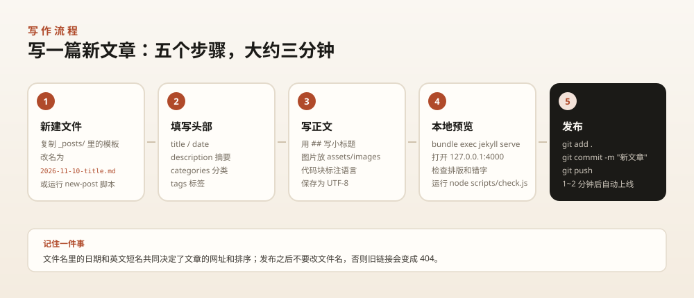

# 写文章指南：新增、修改、删除一篇博客

> 你只需要会三件事：**新建一个 `.md` 文件**、**写对开头的几行配置**、**推送**。
> 全部内容都在 `_posts/` 文件夹里。下面按「怎么做 → 为什么 → 出错怎么办」的顺序写。



---

## 目录

- [一、最快的上手方式](#一最快的上手方式)
- [二、文章文件名的规则](#二文章文件名的规则)
- [三、开头的配置（front matter）](#三开头的配置front-matter)
- [四、正文怎么写](#四正文怎么写)
- [五、插图与封面](#五插图与封面)
- [六、修改已发布的文章](#六修改已发布的文章)
- [七、删除文章](#七删除文章)
- [八、草稿与定时发布](#八草稿与定时发布)
- [九、发布与验证](#九发布与验证)
- [十、常见错误对照表](#十常见错误对照表)

---

## 一、最快的上手方式

### 方式 1：复制模板（最直观，推荐新手）

1. 打开 `_posts/` 文件夹
2. 复制 `0000-00-00-template.md`
3. 粘贴到同目录，重命名为：

```text
2026-11-10-my-first-post.md
```

4. 用任何文本编辑器打开（推荐 **VS Code**，免费）
5. **删掉文件里 `published: false` 这一行**（否则不会被发布）
6. 改标题、日期、摘要，写正文，保存
7. 推送（见第九节）

### 方式 2：命令行脚本（最快，适合熟手）

**Windows（PowerShell 5.1 及以上）：**

```powershell
cd 你的博客目录
powershell -ExecutionPolicy Bypass -File scripts\new-post.ps1 "我的第一篇文章" "随笔"
```

**macOS / Linux：**

```bash
cd 你的博客目录
bash scripts/new-post.sh "我的第一篇文章" 随笔
```

脚本会自动按今天的日期建好文件并填好头部配置，你只需要打开继续写。

> 如果标题是纯中文，脚本会用日期做文件名（比如 `2026-11-10-post-2026-11-10.md`）。建议把文件名后半段手动改成英文，例如 `2026-11-10-reading-notes.md`，这样网址更好看。

### 方式 3：直接在 GitHub 网页上写

1. 在仓库里进入 `_posts` 文件夹
2. 右上角 **Add file → Create new file**
3. 文件名填 `2026-11-10-my-post.md`
4. 内容照第三节的格式写
5. 页面底部 **Commit changes**

适合在手机或别人的电脑上临时发一篇。

---

## 二、文章文件名的规则

文件名长这样：

```text
2026-11-10-my-first-post.md
└─────┬─────┘└──────┬──────┘
     日期         英文短名（slug）
```

### 日期部分

- 格式必须是 `YYYY-MM-DD`，例如 `2026-11-10`
- 决定文章在列表里的**排序**（越新越靠前）
- 决定文章的**网址日期**（虽然网址默认不含日期，但归档页按它分组）
- 可以写过去的日期（补发旧文章）
- 如果写**未来**的日期，Jekyll 默认不会构建它（相当于定时发布，见第八节）

### 英文短名部分

- 决定文章的网址：

```text
文件名：2026-11-10-my-first-post.md
网址：  https://example.com/posts/my-first-post/
```

- 建议：**全小写、用连字符分隔、只用字母数字**，例如 `reading-notes-2026`
- 可以用中文（`2026-11-10-读书笔记.md`），网址会被编码成 `%E8%AF%BB...`，不好看也不好分享
- ⚠️ **发布后不要改文件名**，否则旧链接全部 404

### 合法与不合法的例子

| 文件名 | 结果 |
| --- | --- |
| `2026-11-10-hello.md` | ✅ 正常 |
| `2026-11-10-hello-world.md` | ✅ 正常，网址 `/posts/hello-world/` |
| `2026-11-10-Hello.md` | ⚠️ 能用，但网址是大写，转小写更规范 |
| `2026-1-1-hello.md` | ❌ 日期必须补零，应为 `2026-01-01` |
| `hello.md` | ❌ 没有日期，不会被识别为文章 |
| `2026-11-10_hello.md` | ❌ 日期和短名之间必须是 `-` |

---

## 三、开头的配置（front matter）

每个文件最开头，两条 `---` 之间的部分叫 front matter，用 YAML 语法：

```yaml
---
title: 我的第一篇文章
date: 2026-11-10 20:00:00 +0800
description: 一句话说明这篇写了什么，会显示在列表卡片和搜索结果里。
categories: [随笔]
tags: [生活, 记录]
---
```

### 字段说明

| 字段 | 必填 | 作用 | 示例 |
| --- | :---: | --- | --- |
| `title` | ✅ | 文章标题 | `title: 读《人类简史》` |
| `date` | ✅ | 发布时间 | `date: 2026-11-10 20:00:00 +0800` |
| `description` | 建议 | 摘要，显示在卡片和搜索里 | `description: 一本书读了三遍之后的想法` |
| `categories` | 否 | 分类，决定归到哪个栏目 | `categories: [读书]` |
| `tags` | 否 | 标签，用于检索 | `tags: [历史, 人类学]` |
| `cover` | 否 | 封面图，显示在卡片顶部 | `cover: /assets/images/posts/book.jpg` |
| `featured` | 否 | `true` 时出现在首页「精选文章」 | `featured: true` |
| `toc` | 否 | `false` 时关闭右侧目录 | `toc: false` |
| `updated` | 否 | 最后更新日期 | `updated: 2026-11-15` |
| `published` | 否 | `false` 时**不发布**（草稿） | `published: false` |
| `license` | 否 | 自定义版权说明 | `license: 本文禁止转载` |

### 几个容易写错的地方

**① 冒号后面必须有空格**

```yaml
title:我的文章     # ❌ 错，冒号后没空格
title: 我的文章    # ✅ 对
```

**② 含有特殊字符的值要加引号**

```yaml
title: 读书笔记：第一章      # ⚠️ 冒号在中间容易解析出错
title: "读书笔记：第一章"    # ✅ 用引号包起来
```

冒号、`#`、`[`、`{` 这些字符出现在值里时，加英文双引号最保险。

**③ 日期格式**

```yaml
date: 2026-11-10                      # ✅ 可以，默认 00:00
date: 2026-11-10 20:00:00             # ✅ 可以
date: 2026-11-10 20:00:00 +0800       # ✅ 最推荐，明确时区
date: 2026/11/10                      # ❌ 不要用斜杠
date: 2026-11-10 8:00 PM              # ❌ 不要用 12 小时制
```

**④ 分类和标签的写法**

```yaml
categories: [技术]                  # ✅ 单个
categories: [技术, 前端]            # ✅ 多个
categories:
  - 技术
  - 前端                            # ✅ 多行写法，等价

tags: [JavaScript, 性能]            # ✅ 标签随意，可以有空格和大小写
```

分类建议只设 3~6 个（分类页会按它分组），标签可以随意多一些。

**⑤ 缩进只能用空格，不能用 Tab**

YAML 对缩进极其敏感。编辑器里把 Tab 转成 2 个空格。

---

## 四、正文怎么写

正文用 **Markdown** 语法。完整示例见示例文章 `2026-11-08-markdown-guide.md`，这里给速查：

### 最常用的十种写法

````markdown
## 二级标题（文章的小节，会自动进右侧目录）
### 三级标题（小节内的小点）

普通段落。段落之间空一行。

**加粗**、*斜体*、~~删除线~~、`行内代码`

[链接文字](https://example.com)
[站内链接](/posts/hello-world/)

- 无序列表
- 第二项

1. 有序列表
2. 第二项

> 引用：适合放金句或他人的话


| 表头 | 表头 |
| --- | --- |
| 内容 | 内容 |

```bash
代码块第一行写语言名，比如 bash / javascript / python
```

---
（三个减号是分割线）
````

### 写作时的排版建议

| 建议 | 说明 |
| --- | --- |
| 标题只用 `##` 和 `###` | 文章标题已经是页面最高级标题，正文再用 `#` 会混乱 |
| 段落别太长 | 手机屏幕上 3~5 行一段最好读 |
| 每段只讲一件事 | 想换话题就开新段 |
| 代码块标注语言 | 不标也会显示，但标了才有高亮 |
| 图片加说明文字 | `` 里的说明既是无障碍描述，也是加载失败时的提示 |
| 多用列表和表格 | 中文长句里放列表，读者会感谢你 |

### 本站特有的写法

**提示框**（用引用块加粗开头）：

```markdown
> **提示**：这是一段提示。加粗的"提示"二字要在冒号前。
```

**图注**（需要 HTML 标签）：

```html
<figure>
  
  <figcaption>图片下方的图注文字</figcaption>
</figure>
```

**折叠内容**（需要 HTML 标签，适合放长代码）：

```html
<details>
<summary>点击展开完整代码</summary>

这里放内容，注意和标签之间空一行。

</details>
```

---

## 五、插图与封面

### 5.1 放图片

所有图片放在：

```text
assets/images/posts/
```

建议按文章起名，方便管理：

```text
assets/images/posts/2026-11-10-reading-notes-1.jpg
assets/images/posts/2026-11-10-reading-notes-2.jpg
```

### 5.2 在文章里插入

```markdown

```

⚠️ 注意三点：

1. 路径**以 `/` 开头**（相对网站根目录）
2. **大小写必须和文件名完全一致**（GitHub 的服务器区分大小写，Windows 不区分，这是最常见的"本地好好的，线上裂图"原因）
3. 文件名不要有空格、中文标点、`#`、`?`

### 5.3 设置封面

在文章头部加：

```yaml
cover: /assets/images/posts/2026-11-10-reading-notes-1.jpg
```

封面会显示在首页卡片、文章列表卡片上，比例建议 **16:9**（比如 1280×720）。

没设封面也不会空着——会用分类名的首字做一个渐变占位图。

### 5.4 图片压缩（很重要）

一张手机原图 5MB，会拖慢整站。发布前压缩到 **500KB 以内**：

- 在线工具：[Squoosh](https://squoosh.app/)（免费，可调质量）
- 命令行：`npx sharp-cli --input a.png --output a.jpg --quality 80`
- Windows 自带「画图」另存为 JPG 也能压

运行 `node scripts/check.js` 会检查超过 500KB 的图片并提醒你。

---

## 六、修改已发布的文章

### 改标题、正文、摘要

直接用编辑器打开对应的 `.md` 文件改，然后：

```bash
git add .
git commit -m "修改：文章标题"
git push
```

1~2 分钟后线上更新。

### 改标题但不改网址

标题在文件里（`title`），网址在文件名里。所以：

- 只改 `title` → 网址**不变** ✅ 安全
- 改文件名 → 网址**变了**，旧链接 404 ⚠️

### 更新日期怎么标

不要改 `date`（会改变排序）。加一行：

```yaml
updated: 2026-11-15
```

文章页会显示「最后更新 2026-11-15」。

### 改分类

改 `categories` 即可，分类页和归档页会跟着变；不需要手动维护任何列表。

---

## 七、删除文章

1. 删除 `_posts/` 里对应的 `.md` 文件
2. 如果文章引用了独有的图片，把 `assets/images/posts/` 里对应的图片也删掉（可选）
3. 推送：

```bash
git add -A
git commit -m "删除：文章标题"
git push
```

> 删除后 1~2 分钟生效。已经搜到旧链接的搜索引擎会在几周内慢慢更新，这是正常的。

---

## 八、草稿与定时发布

### 写一半先存着

在头部加一行：

```yaml
published: false
```

文件可以放在 `_posts/` 里，但**不会出现在网站上**。等写完了把这一行删掉再推送。

### 定时发布

把 `date` 写成未来的时间，例如：

```yaml
date: 2026-12-01 09:00:00 +0800
```

GitHub 每次构建时，只发布 `date` 已到的文章。所以：

- 推送后不会立刻出现
- 但 GitHub Pages **不会主动在 12 月 1 日重新构建**——需要那天有新的推送，或者你手动去 Actions 里重跑一次构建

所以「定时」并不完全可靠。更稳的做法是**到日子再推送**。

---

## 九、发布与验证

### 9.1 发布三步

```bash
# 1. 自检（检查链接、图片、front matter）
node scripts/check.js

# 2. 本地预览（如果你装了 Ruby）
bundle exec jekyll serve

# 3. 提交并推送
git add .
git commit -m "新文章：文章标题"
git push
```

### 9.2 用 GitHub Desktop 发布（图形界面）

1. 打开 GitHub Desktop，左侧会列出你的改动
2. 左下角填写提交信息（Summary）：`新文章：文章标题`
3. 点 **Commit to main**
4. 点右上角 **Push origin**

### 9.3 发布后检查

- [ ] 打开 `https://你的域名/posts/你的英文短名/`，页面正常
- [ ] 首页出现了这篇新文章
- [ ] 分类页、归档页里能找到它
- [ ] 搜索页能搜到（搜标题里的词）
- [ ] 图片正常显示（重点检查大小写）
- [ ] 手机上打开排版正常

> 如果没更新，先等 2 分钟，再强制刷新浏览器（Windows：`Ctrl+F5`；macOS：`Cmd+Shift+R`）。

### 9.4 改了没生效？

| 现象 | 原因 | 解决 |
| --- | --- | --- |
| 等了 5 分钟还没变 | 构建排队 | Actions 标签页看是否还在跑 |
| Actions 显示失败 | 配置写错 | 点进日志看报错行 |
| 页面是旧的 | 浏览器缓存 | 强制刷新 / 无痕模式 |
| 新文章没出现 | `published: false` 没删 | 删掉那行 |
| 新文章没出现 | 日期是未来 | 改成今天或更早 |
| 中文乱码 | 文件不是 UTF-8 | 编辑器里另存为 UTF-8（无 BOM） |

---

## 十、常见错误对照表

### 构建失败类（Actions 里红色叉号）

| 日志里的关键词 | 你写错了什么 | 怎么改 |
| --- | --- | --- |
| `did not find expected key` | YAML 缩进或冒号问题 | 检查头部每行，冒号后要有空格，缩进用空格 |
| `Invalid date` | 日期格式不对 | 改成 `2026-11-10 20:00:00 +0800` |
| `Liquid syntax error` | 正文里出现了两对花括号 | 用 `&#123;&#123;` 转义，或改成行内代码并转义 |
| `could not read file` | 图片路径错误 | 检查路径和大小写 |
| `Permission denied` | 文件权限问题 | 一般不会遇到，重新推送一次 |

### 显示错乱类（能打开但不对）

| 现象 | 原因 | 解决 |
| --- | --- | --- |
| 标题变成文件名 | `title` 没写或写错 | 检查 `title:` 那一行 |
| 整篇文章挤成一坨 | 段落之间没空行 | 每段之间留一个空行 |
| 代码块没有高亮 | 没标语言 | 三个反引号后面加语言名，如 `bash` |
| 目录是空的 | 正文没有 `##` 小标题 | 加至少一个小标题 |
| 分类页没有这篇 | `categories` 拼写错误 | 检查拼写，注意中英文括号 |
| 图片裂开 | 路径/大小写错误 | 用浏览器 F12 看图片请求的实际地址 |

---

## 附：一篇文章的完整示例

```markdown
---
title: 我在杭州的第三年
date: 2026-11-10 20:30:00 +0800
description: 搬家三次、换了两份工作、学会做三道菜。三年时间在这个城市留下了什么。
categories: [随笔]
tags: [杭州, 生活, 年度总结]
cover: /assets/images/posts/hangzhou-year-3.jpg
---

来杭州的第三年，我终于不再需要导航就能从公司走回家。

## 搬家

第一年住在城西，第二年搬到滨江，第三年又搬回了城西。

> 每一次搬家，都是在重新回答"我想过什么样的生活"。

## 工作

换了两次工作，最大的收获不是薪资，而是知道了自己**不喜欢**什么。

### 第一份工作

做的是企业服务，代码很规整，但离用户很远。

### 第二份工作

做的是消费产品，每天都能看到用户的反馈，累但踏实。

## 做饭

学会了三道菜：

1. 番茄炒蛋（第一道，也是唯一一道从不失手的）
2. 红烧排骨（糖色炒糊过三次）
3. 蒜蓉西兰花（健康，但不好吃）

## 最后

三年不长，但足够让一个城市从"陌生的地方"变成"我的地方"。

下一个三年，希望能少搬几次家。
```

把上面这段存成 `_posts/2026-11-10-hangzhou-year-3.md`，推送，就是一个完整的文章页了。
