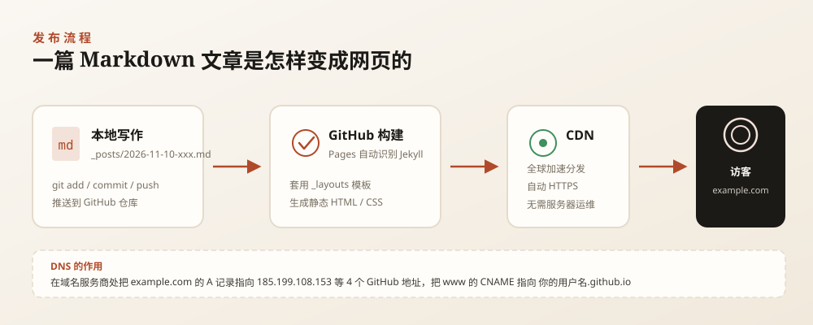

# 部署指南：把博客放到 GitHub Pages 并绑定自己的域名

> 这份文档假设你：**已经有一个域名**，电脑上能装软件，但没做过网站部署。
> 全文按顺序执行即可。每一步都给了「怎么验证」，**上一步没通过就别急着往下走**。
>
> 预计耗时：40 分钟（不含 DNS 生效等待）。

---

## 目录

- [0. 开工前的准备](#0-开工前的准备)
- [1. 认识这套文件](#1-认识这套文件)
- [2. 注册 GitHub 并建仓库](#2-注册-github-并建仓库)
- [3. 把文件传上去](#3-把文件传上去)
- [4. 开启 GitHub Pages](#4-开启-github-pages)
- [5. 用默认地址先看效果](#5-用默认地址先看效果)
- [6. 配置 DNS](#6-配置-dns)
- [7. 绑定自定义域名](#7-绑定自定义域名)
- [8. 开启 HTTPS 并改配置](#8-开启-https-并改配置)
- [9. 本地预览环境（可选，强烈推荐）](#9-本地预览环境可选强烈推荐)
- [10. 上线检查清单](#10-上线检查清单)
- [11. 出问题了怎么办](#11-出问题了怎么办)
- [12. 日常维护](#12-日常维护)



---

## 0. 开工前的准备

### 需要的东西

| 项目 | 说明 |
| --- | --- |
| 一个域名 | 例如 `example.com`，在腾讯云 / 阿里云 / Cloudflare / Namecheap 等任何服务商买的都行 |
| 域名管理权限 | 能登录服务商后台修改 DNS 解析记录 |
| 一个 GitHub 账号 | 没有就注册，免费版足够 |
| 本机装 Git | Windows 装 [Git for Windows](https://git-scm.com/download/win)；macOS 执行 `git --version` 按提示装 |

### 先想清楚两件事

**① 主域名用哪个？**

- `example.com`（不带 www）—— 推荐，短，好记
- `www.example.com` —— 也行，但网址长一点
- `blog.example.com` —— 适合和主站分开

两种都配其实最稳：主域名给博客用，`www` 自动跳过来。

**② 仓库叫什么？**

本站是**个人博客**，用「用户主页仓库」最简单，仓库名必须是：

```text
你的GitHub用户名.github.io
```

例如用户名是 `zhangsan`，仓库名就是 `zhangsan.github.io`。这样博客直接占用网址根路径 `/`，不用折腾 `baseurl`。

> 如果你已经有同名仓库，就用它；如果没有，下面第 2 步会新建。

---

## 1. 认识这套文件

先花两分钟搞清目录结构，后面找东西会快很多：

```text
github-blog/
├── _config.yml          ← 全站配置：站名、作者、导航、域名（你要改的第一个文件）
├── index.html           ← 首页
├── about.md             ← 关于页
├── posts.md             ← 文章列表页
├── archive.md           ← 归档页
├── categories.md        ← 分类页
├── search.md            ← 搜索页
├── search.json          ← 搜索索引（自动生成，别删）
├── 404.html             ← 404 页面
├── CNAME                ← 自定义域名（只写一行域名）
├── robots.txt           ← 给搜索引擎的说明
├── Gemfile              ← 本地预览用的 Ruby 依赖
│
├── _posts/              ← ★ 所有文章都在这里
│   ├── 0000-00-00-template.md        ← 模板（不会被发布）
│   ├── 2026-11-08-hello-world.md
│   ├── 2026-11-08-markdown-guide.md
│   └── 2026-11-08-deploy-to-github-pages.md
│
├── _layouts/            ← 页面骨架
├── _includes/           ← 可复用的小组件（页头、页脚、文章卡片）
├── assets/
│   ├── css/style.css    ← 所有样式
│   ├── js/              ← 交互脚本
│   └── images/          ← 图片、头像、图标
│
├── docs/                ← 文档（不会被发布，可以删）
│   ├── 部署指南.md      ← 本文
│   └── 写文章指南.md
│
└── scripts/
    ├── new-post.sh      ← 新建文章脚本（macOS / Linux）
    ├── new-post.ps1     ← 新建文章脚本（Windows）
    ├── check.js         ← 发布前自检
    └── preview-server.js← 本地静态预览（不用 Ruby）
```

**你只需要经常碰两处**：`_posts/`（写文章）和 `_config.yml`（改站名、域名）。

---

## 2. 注册 GitHub 并建仓库

### 2.1 注册

打开 <https://github.com>，点 **Sign up**，用邮箱注册。用户名会出现在默认网址里，**想好再填**（以后能改，但麻烦）。

### 2.2 新建空仓库

1. 登录后点右上角 **+** → **New repository**
2. **Repository name** 填 `你的用户名.github.io`
   （例如用户名 `zhangsan`，就填 `zhangsan.github.io`，必须完全一致）
3. 可见性选 **Public**
   （免费账号的 Pages 必须是公开仓库）
4. **不要**勾选 "Add a README file"、"Add .gitignore"、"Choose a license"
5. 点 **Create repository**

完成后你会看到一个空仓库页面，上面有推送代码的命令提示。

---

## 3. 把文件传上去

有两种方式，**任选一种**。

### 方式 A：网页上传（最简单，适合第一次）

1. 在自己电脑上打开 `github-blog` 文件夹，**全选里面的内容**（注意是文件夹**里面**的文件，不是文件夹本身）
2. 在 GitHub 仓库页面点 **Add file → Upload files**
3. 把文件拖进浏览器窗口
4. ⚠️ **重要**：Windows 默认隐藏以 `.` 开头的文件，`_config.yml`、`_posts` 这些都能看到，但 `.gitignore` 可能没选上——**没关系，`.gitignore` 不是必需的**，其他文件在就行
5. 页面底部 **Commit changes** 里写一句 `初始化博客`，点 **Commit changes**

> 网页上传有个限制：一次最多 100 个文件、单个文件不超过 25MB。本站文件数远小于这个数，没问题。

### 方式 B：命令行（推荐，以后改文章都靠它）

先在 GitHub 上建好空仓库（同 2.2），然后在本机执行：

```bash
cd 你的博客文件夹路径
git init
git add .
git commit -m "初始化博客"
git branch -M main
git remote add origin https://github.com/你的用户名/你的用户名.github.io.git
git push -u origin main
```

首次推送会要求登录：

- **用户名**：你的 GitHub 用户名
- **密码**：**不能用账号密码**，要填 **Personal Access Token（PAT）**

获取 PAT：GitHub 右上角头像 → **Settings** → 左侧最底部 **Developer settings** → **Personal access tokens → Tokens (classic)** → **Generate new token (classic)** → 勾选 `repo` 权限 → 生成后**立刻复制**（只显示一次）。

当 Git 弹出密码框时，粘贴这串 token。

> 也可以装 [GitHub Desktop](https://desktop.github.com/)，用图形界面完成 clone / commit / push，免去 token 的麻烦，适合不熟悉命令行的朋友。

### 3.3 验证

刷新仓库页面，应该能看到：

- `_config.yml`
- `_posts` 文件夹
- `index.html`
- `assets` 文件夹

如果 `_posts` 不在，说明上传时只传了文件夹里的部分文件，重来一次。

---

## 4. 开启 GitHub Pages

1. 进入仓库 → **Settings**（顶部标签栏）
2. 左侧菜单找到 **Pages**
3. **Source** 选 `Deploy from a branch`
4. **Branch** 选 `main`，右侧目录保持 `/ (root)`
5. 点 **Save**

页面顶部会出现：

```text
Your site is live at https://你的用户名.github.io/
```

> **不需要**写 GitHub Actions 配置文件。GitHub Pages 会自动识别 Jekyll 项目并构建，本站不依赖任何第三方插件。

### 4.1 等待构建

首次构建通常 1~3 分钟。可以在仓库顶部 **Actions** 标签页看到 `pages build and deployment` 的运行记录：

- 🟡 黄色圆点 = 正在构建
- ✅ 绿色对勾 = 构建成功
- ❌ 红色叉号 = 构建失败（点进去看日志，见第 11 节）

---

## 5. 用默认地址先看效果

打开 `https://你的用户名.github.io/`。

**这一步很重要**：它是"排除法"的分界线。

- ✅ **能打开** → 说明仓库、构建、模板都没问题，后面只差域名
- ❌ **打不开** → 先解决这里，别碰域名（见第 11 节）

打开后顺便点一遍导航：文章、分类、归档、搜索、关于。如果都正常，就可以配域名了。

---

## 6. 配置 DNS

登录你的**域名服务商**后台，找到 DNS 解析（不同服务商叫法不同：DNS 管理 / 域名解析 / 解析设置）。

### 6.1 主域名 `example.com`（推荐方案）

添加 **4 条 A 记录**，主机记录填 `@`（有的服务商显示为"留空"或域名本身）：

| 类型 | 主机记录 | 记录值 | TTL |
| --- | --- | --- | --- |
| A | @ | 185.199.108.153 | 600 |
| A | @ | 185.199.109.153 | 600 |
| A | @ | 185.199.110.153 | 600 |
| A | @ | 185.199.111.153 | 600 |

这 4 个 IP 是 GitHub Pages 的官方地址，必须**四条都加**，少一条在部分网络环境下会打不开。

### 6.2 同时配置 `www`

再添加 **1 条 CNAME 记录**：

| 类型 | 主机记录 | 记录值 | TTL |
| --- | --- | --- | --- |
| CNAME | www | 你的用户名.github.io | 600 |

⚠️ 记录值**不要**带 `https://`，**不要**带路径，**不要**在末尾加点号。

### 6.3 如果主域名用的是 `blog.example.com`

那就只加一条 CNAME：

| 类型 | 主机记录 | 记录值 |
| --- | --- | --- |
| CNAME | blog | 你的用户名.github.io |

### 6.4 检查解析是否生效

在电脑上打开终端（Windows 是 PowerShell 或 CMD）：

```bash
nslookup example.com
nslookup www.example.com
```

看到返回的 IP 里有 `185.199.108.153` 之类的地址，就说明解析生效了。

- 一般 **10 分钟 ~ 1 小时**生效，最长可能 24 小时
- 刚改完立刻查不到是正常的，别慌
- 如果服务商支持，把 TTL 先设成 600 秒，验证更快

**可以并行往下做**：DNS 在等，你先完成第 7 步的 CNAME 文件。

---

## 7. 绑定自定义域名

### 7.1 修改 `CNAME` 文件

仓库根目录有个 `CNAME` 文件，打开它，把内容改成一**行**你的域名：

```text
example.com
```

在 GitHub 网页上改：点开 `CNAME` → 右上角铅笔图标 → 修改 → **Commit changes**。

> 注意：只能有一行，不能有空格、注释、`https://`。

### 7.2 在 Pages 设置里填写域名

1. 仓库 → **Settings → Pages**
2. **Custom domain** 输入框填 `example.com`
3. 点 **Save**

GitHub 会立即做一次 DNS 检查：

- ✅ 检查通过：显示 "DNS check successful"
- ⚠️ 还没生效：显示 "DNS check unsuccessful" 或一直转圈——**等 DNS 生效后再点 Save 一次**

### 7.3 验证

浏览器打开：

```text
http://example.com
```

能打开，说明域名绑定成功（此时可能还没有 https）。

---

## 8. 开启 HTTPS 并改配置

### 8.1 强制 HTTPS

回到 **Settings → Pages**，等 Custom domain 下方出现 **Enforce HTTPS** 复选框后勾选它。

- 如果复选框是灰色的，说明证书还在签发，通常等 15 分钟 ~ 24 小时
- 勾选后，`http://` 会自动跳转 `https://`

### 8.2 把域名写进 `_config.yml`

打开 `_config.yml`，找到这两行：

```yaml
url: ""
baseurl: ""
```

改成：

```yaml
url: "https://example.com"
baseurl: ""
```

> - `url` 末尾**不要**加斜杠
> - `baseurl` 保持空字符串（用自定义域名或 `用户名.github.io` 仓库时都是空）
> - 如果你的博客部署在**子路径**下（例如仓库不是 `用户名.github.io`，而是普通仓库，网址是 `用户名.github.io/blog`），才需要 `baseurl: "/blog"`

提交修改后，等 1 分钟刷新页面。

### 8.3 验证 HTTPS 和配置

逐条确认：

- [ ] `https://example.com` 能打开，地址栏有小锁
- [ ] `http://example.com` 自动跳转到 https
- [ ] `https://www.example.com` 能打开（或跳转到主域名）
- [ ] 手机用 4G 流量（不连 WiFi）也能打开
- [ ] 查看网页源代码，`<link rel="canonical" href="https://example.com/...">` 里是正确域名

---

## 9. 本地预览环境（可选，强烈推荐）

线上改一次等一分钟，本地改一次 0 秒。**长期写博客一定要装本地环境。**

### 9.1 方案一：完整 Jekyll（最准确，推荐）

#### Windows

1. 打开 <https://rubyinstaller.org/downloads/>，下载 **Ruby+Devkit 3.3.x (x64)** 安装包
2. 安装时**勾选** "Add Ruby executables to your PATH"
3. 安装到最后会弹出 `ridk install`，直接回车选默认的 `1,3` 即可
4. 打开 **新的** PowerShell 窗口，验证：

```powershell
ruby -v
gem -v
```

5. 进入博客目录，安装依赖：

```powershell
cd 你的博客目录
bundle install
```

如果提示找不到 bundle，先执行 `gem install bundler`。

6. 启动本地服务：

```powershell
bundle exec jekyll serve
```

7. 打开 <http://127.0.0.1:4000>

#### macOS

```bash
# 装 Homebrew（已装可跳过）
/bin/bash -c "$(curl -fsSL https://raw.githubusercontent.com/Homebrew/install/HEAD/install.sh)"

brew install ruby
echo 'export PATH="/opt/homebrew/opt/ruby/bin:$PATH"' >> ~/.zshrc
source ~/.zshrc

cd 你的博客目录
bundle install
bundle exec jekyll serve
```

打开 <http://127.0.0.1:4000>。

> 修改 `_config.yml` 后需要重启服务；只改文章和样式会自动刷新（加 `--livereload` 参数可以自动刷新浏览器）。

### 9.2 方案二：Docker（不装 Ruby）

```bash
cd 你的博客目录
docker run --rm -it -p 4000:4000 -v "$PWD:/srv/jekyll" jekyll/jekyll:pages jekyll serve --livereload
```

Windows PowerShell 里把 `"$PWD:/srv/jekyll"` 换成 `"${PWD}:/srv/jekyll"`。

### 9.3 方案三：不用 Ruby 的完整预览（推荐给不想装 Ruby 的人）

仓库里带了一个「半个 Jekyll」，用 Node.js 把真实文章渲染成静态页面，效果和线上基本一致：

```bash
cd 你的博客目录
npm install                 # 只装一次，大约 10 秒
npm run preview             # 构建并启动
```

打开 <http://127.0.0.1:8766>。

改动文章或 CSS 后，重新执行 `npm run build:preview` 刷新即可（不用重启服务）。

> 说明：它实现的是 Jekyll 的核心逻辑（front matter、layout 嵌套、include、常用过滤器），
> 足以检查排版和交互，但**正式发布仍以 GitHub Pages 的构建为准**。
> 装不了 Node.js 也可以只用方案一。

### 9.4 方案四：只调样式（最轻量）

如果只想看 CSS 改动，用自带的静态服务器直接预览源码目录：

```bash
node scripts/preview-server.js
```

打开 <http://127.0.0.1:8765>。

> 它**不渲染 Jekyll 模板**，`{{ }}` 里的变量会原样显示。只适合调样式，不适合看文章效果。

---

## 10. 上线检查清单

发布前把这张表过一遍：

- [ ] `_config.yml` 里 `title`、`tagline`、`author`、`url` 都改成了自己的
- [ ] `CNAME` 文件里只有一行正确域名
- [ ] Settings → Pages 里 Custom domain 显示正确，且有绿色对勾
- [ ] Enforce HTTPS 已勾选
- [ ] 首页、文章页、分类页、归档页、搜索页、关于页都能正常打开
- [ ] 任一篇文章里的目录（右上角）能点、滚动时高亮跟随
- [ ] 明暗主题切换正常，刷新后保持选择
- [ ] 手机上打开，导航折叠正常、文章不横向溢出
- [ ] 运行 `node scripts/check.js`，没有错误
- [ ] 删掉了示例文章和示例说明（或改成自己的内容）
- [ ] 把 `docs/` 文件夹设为不部署（已默认排除，见 `_config.yml` 的 `exclude`）

---

## 11. 出问题了怎么办

### 页面 404

| 可能原因 | 怎么查 |
| --- | --- |
| 仓库名拼错 | 必须是 `用户名.github.io`，和用户名完全一致 |
| Pages 没开 | Settings → Pages → Source 是否为 `Deploy from a branch` + `main` + `/ (root)` |
| 没有首页 | 根目录必须有 `index.html` |
| 构建失败 | Actions 标签页看红色记录 |

### 打开显示的是 README

Jekyll 会把根目录的 `README.md` 当首页。本站有 `index.html`，正常情况下不会出现；如果出现了，确认 `index.html` 是否被误删。

### Actions 里构建失败

点开红色的 `pages build and deployment`，看日志最后几行，常见错误：

| 日志关键词 | 含义 | 解决 |
| --- | --- | --- |
| `Liquid Exception` | 模板语法错误 | 最近改过的模板/文章里有写错的 Liquid 语法 |
| `did not find expected key` | YAML 格式错误 | 检查 `_config.yml` 或文章头部的缩进、冒号后是否有空格 |
| `Invalid date` | 日期格式错误 | 头部 `date` 要写成 `2026-11-10 20:00:00 +0800` |
| `Unknown tag` | 用了 Pages 不支持的插件标签 | 删掉那行，或改用标准 Markdown |

### 域名打不开，但 `用户名.github.io` 正常

1. `nslookup example.com` 看是否解析到 `185.199.x.x`
2. DNS 后台确认 4 条 A 记录都在
3. 确认 `CNAME` 文件里写的就是这个域名（不能有多余字符）
4. Settings → Pages 里重新点一次 Save，触发重新检查
5. 还不行就等——DNS 最长 24 小时

### 提示 "Domain is not properly formatted"

`CNAME` 文件内容不合法。只留一行纯域名，例如 `example.com`。

### HTTPS 一直灰色

- 通常是证书还在签发，等 15 分钟 ~ 24 小时
- 检查域名是否已能通过 `http://` 正常访问
- 删掉 DNS 里多余的 AAAA 记录（IPv6），有时会干扰验证

### 图片不显示

- 路径是否以 `/assets/` 开头
- 文件名**大小写**是否与仓库里完全一致（Linux 服务器区分大小写，Windows 本地不区分，这是最容易踩的坑）
- 文件名里不要有空格和中文标点

### 页面样式错乱

- 打开浏览器开发者工具（F12）→ Console，看有没有 404 的 CSS/JS
- 确认 `_config.yml` 的 `baseurl` 是空字符串 `""`

---

## 12. 日常维护

### 发布一篇文章

```bash
# 1. 写文章（详见 docs/写文章指南.md）
# 2. 自检
node scripts/check.js

# 3. 本地预览
bundle exec jekyll serve

# 4. 推送
git add .
git commit -m "新文章：文章标题"
git push
```

推送后 1~2 分钟自动上线。

### 修改站点信息

改 `_config.yml` → 推送。注意：改了 `_config.yml` 需要等 GitHub 重新构建，本地预览也要重启服务。

### 备份

GitHub 仓库本身就是备份。建议：

- 本地保留一份完整文件夹
- 每隔一段时间执行 `git pull` 保持同步
- 重要文章另存到笔记软件

### 换域名

1. 新域名服务商处配置 DNS（同第 6 步）
2. 改 `CNAME` 文件为新域名
3. Settings → Pages 里 Custom domain 改为新域名，重新 Save
4. 改 `_config.yml` 的 `url`
5. 旧域名如果还想用，在 DNS 里做 301 跳转（GitHub Pages 不支持直接配置，需要域名服务商的转发功能）

### 想让网站更快

- 图片压缩到 500KB 以内（推荐 [Squoosh](https://squoosh.app/)）
- 封面图用 `.jpg` 而不是 `.png`
- 不要引入大型第三方 JS 库

---

## 附：你需要改的占位符清单

全站搜索这些词，逐个替换：

| 占位符 | 出现位置 | 改成 |
| --- | --- | --- |
| `我的博客` | `_config.yml`、OG 图 | 你的站名 |
| `你的名字` | `_config.yml`、关于页 | 你的名字 |
| `hello@example.com` | `_config.yml`、关于页 | 你的邮箱 |
| `https://github.com/yourname` | `_config.yml` | 你的 GitHub |
| `example.com` | `CNAME`、`robots.txt`、`_config.yml` | 你的域名 |
| `你的用户名.github.io` | 本文档示例 | 你的 GitHub 用户名 |

改完之后，把 `_posts/` 里的三篇示例文章删掉或改成自己的内容，就可以开始写了。
